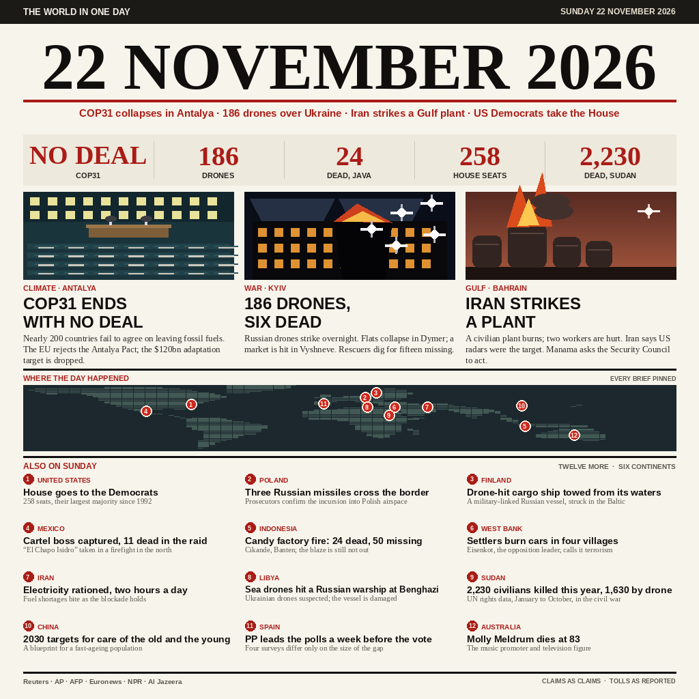

# The World in One Day — 22 November 2026

[](https://make.fun/bounty/news-image-20261122?utm_source=github&utm_medium=readme&utm_campaign=news-image-20261122)
[](https://make.fun/bounty/news-image-20261122/leaderboard?utm_source=github&utm_medium=readme&utm_campaign=news-image-20261122)
[](https://make.fun/bounty/news-image-20261122?utm_source=github&utm_medium=readme&utm_campaign=news-image-20261122)

A single broadsheet front page for Sunday 22 November 2026: fifteen stories from
the day's wires, set as a newspaper page and rendered at 1024×1024.



## What it is

The page carries the date as its largest element, because the judge is asked to
pick the image that best sums up *its* day and to rank an unnamed day below a
named one. Under the masthead a deck names the four biggest stories; a five-column number
rail gives the day's hardest figures; three illustrated leads carry climate, war
and the Gulf; a dot-matrix world map pins every one of the twelve briefs to its
place; and those briefs fill the lower half so the page spans six continents
rather than one beat.

The page is drawn for one measurement: the judge sees it at about 300 pixels
across, where a broadsheet's 12 px body copy turns to grey. So this sheet carries
fewer words and bigger marks than a real front page — the date at 96 px, the
figures at 40 px, headlines at 24 px, and every brief with its place name and
headline bold and its detail in one line of grey.

Fifteen stories, six continents: Antalya (COP31), Ukraine, Bahrain and Iran,
the United States, Indonesia, Sudan, South Sudan, Mongolia, Nigeria, Hong Kong,
Yemen, Somalia, Türkiye, the Philippines, and one sport item from Las Vegas.

## The stories

Leads: COP31 ends in Antalya with no deal, the first failed climate summit since
Copenhagen in 2009; 186 Russian drones over Ukraine with six dead in the Kyiv
region; an Iranian strike on a plant in Bahrain, condemned by Saudi Arabia, Qatar
and the UAE.

Briefs: Democrats take 258 House seats; a candy factory fire at Cikande kills 24
with about 50 missing; UN rights data count 2,230 Sudanese civilian deaths this
year, 1,630 of them by drone; cartel boss "El Chapo Isidro" is captured in
Mexico; three Russian missiles cross into Polish airspace; a drone-hit Russian
cargo ship is towed out of Finnish waters; Ukrainian sea drones are suspected of
hitting a Russian warship at Benghazi; Iran begins rationing electricity; Israeli
settlers burn cars in four West Bank villages; Bangkok moves to block chemicals
for Myanmar's rare earth mines; China sets 2030 care targets; Neves wins a second
term in Cape Verde; Malawi steps up Ebola screening; Nigeria's pipelines are
restored; a Delta outage halts Atlanta; BepiColombo reaches Mercury; Lebanese
villagers return as Israel pulls back; Pashinyan stakes his office on a
referendum; an Uzbek professor gets ten years in Kazakhstan; clashes at Moyale;
Spain's PP leads the polls; South Korea's education minister resigns; Verstappen
wins in Las Vegas; Molly Meldrum dies at 83.

Tolls are shown as reported, and the footer says so.

## How it is built

`build.py` draws the page with Pillow from fixed coordinates and a fixed news
list. It reads no clock, no network and no random source, so it writes the same
bytes on every run.

```sh
python3 build.py          # writes entry/entry.png
```

`main.py` is the entry the harness runs. It copies the composed page to
`/output/entry.png`, and before it copies it holds the file to the gate: the PNG
signature, every chunk's declared length and CRC32, a closing IEND, and the
competition's caps of one mebibyte and 1024 pixels a side. A broken file fails
there with a sentence naming the rule it broke rather than scoring nothing as a
corrupt image.

```sh
MAKEFUN_OUTPUT_DIR=/tmp/out python3 main.py
```

Two runs write identical bytes; there is nothing to differ.

## Notes on the drawing

Type is Liberation Serif and Liberation Sans, chosen for their low-contrast
bookish forms at small sizes. Nothing is set below 11 px, because the judge reads
the page at about 300 pixels across, where finer type turns to grey. The three
lead illustrations are flat vector scenes drawn with primitives — a negotiating
hall, a night strike on a housing block, an industrial fire — because the page
has no photographs and does not pretend to.

## Licence

Entered in [make.fun's "Sum up 22 November's world news in one image" bounty](https://make.fun/bounty/news-image-20261122), which pays $100 in USDC.

MIT.
